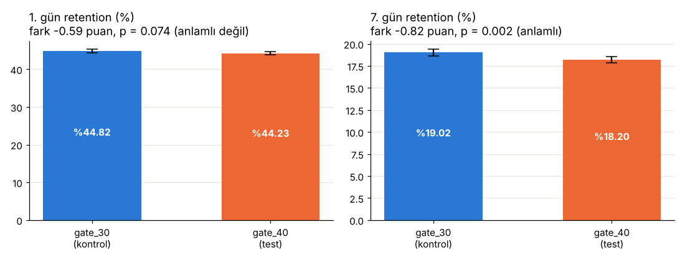
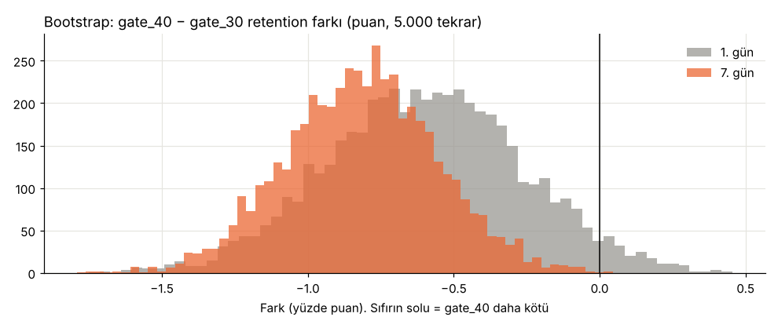
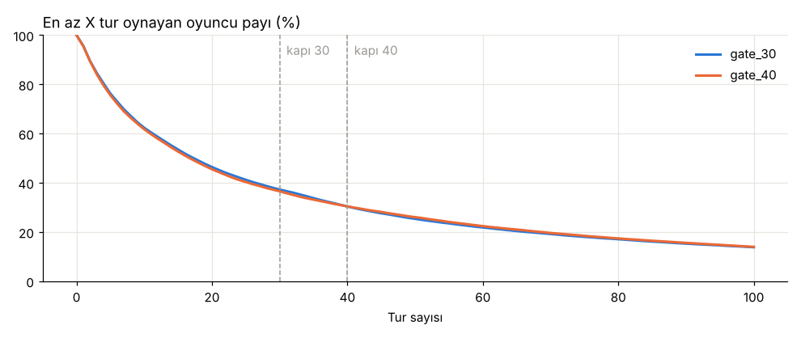

# Cookie Cats A/B Testi: Bekleme Kapısını Taşımak Retention'ı Etkiler mi?

Mobil bulmaca oyunu Cookie Cats'te yapılmış gerçek bir A/B testinin (90.188 oyuncu) uçtan uca analizi.

**Araçlar:** Python (pandas, SciPy, statsmodels, matplotlib) · Jupyter

**Yöntemler:** Deney sağlık kontrolü (SRM) · Güç analizi (MDE) · İki oran z-testi · Bonferroni düzeltmesi · Bootstrap · Mann-Whitney U · İş etkisi tahmini

## İş sorusu

Oyunda belirli bir seviyede oyuncunun beklemesi ya da ödeme yapması gereken bir "kapı" var. Kapı şu an 30. seviyede. Ürün ekibi kapıyı 40. seviyeye taşırsa oyuncuların daha çok oynayacağını ve oyuna daha bağlı kalacağını düşünüyor. **Kapı taşınmalı mı?**

Oyuncular rastgele iki gruba ayrıldı: `gate_30` (kontrol) ve `gate_40` (test).

## Sonuçlar

| Metrik | gate_30 | gate_40 | Fark | p | Sonuç |
|---|---|---|---|---|---|
| 1. gün retention | %44,82 | %44,23 | −0,59 puan | 0,074 | Anlamlı değil |
| 7. gün retention | %19,02 | %18,20 | **−0,82 puan** | 0,002 | **Anlamlı kayıp** |
| Medyan tur sayısı (14 gün) | 17 | 16 | −1 | 0,051 | Pratikte fark yok |

1. **Kapıyı 40'a taşımak 7. gün retention'ı düşürüyor.** Göreli kayıp %4,3. %95 güven aralığı −1,33 ile −0,31 puan arası, yani tamamen sıfırın altında. Bonferroni düzeltmesinden sonra da anlamlı.
2. **Beklenen fayda gerçekleşmiyor.** Oyuncular ilk 14 günde daha fazla oynamıyor.
3. **Bootstrap aynı sonucu veriyor.** gate_30'un 7. gün retention'da daha iyi olma olasılığı %99,9.
4. **İş etkisi.** Ayda 1 milyon kurulum varsayımıyla, her ay 7. günde oyunda kalan ~8.200 oyuncu kaybı (güven aralığı 3.100 – 13.300).

**Karar:** Kapı 30. seviyede kalmalı.

## Deney sağlık kontrolü: SRM

Bu analizi standart çözümlerden ayıran nokta, sonuçlara bakmadan önce deneyin kendisinin kontrol edilmesi:

- Gruplar %50/%50 olmalıydı ama gate_30 grubu kitlenin %49,56'sı (44.699 ve 45.489 oyuncu). Ki-kare testi p = 0,009. Bu bir **Sample Ratio Mismatch (SRM)** işareti.
- Kapıdan önceki davranışta (30'dan az tur oynayan oyuncu payı) da küçük ama anlamlı bir fark var (p = 0,02). Bu, iki grubun tam eşit oluşmamış olabileceği şüphesini güçlendiriyor.

**Öneri:** Kararı uygulamadan önce atama ve kayıt sistemi kontrol edilmeli. Hata bulunursa deney tekrarlanmalı.

## Grafikler

| | |
|---|---|
|  |  |
|  | |

## Analiz adımları

`notebooks/ab_test_analiz.ipynb` dosyasında her bölüm **Neden / Nasıl / Sonuç** yapısında:

1. Veriyi tanıma ve temizleme (1 aykırı oyuncu çıkarıldı: 14 günde 49.854 tur)
2. Deney sağlık kontrolü (SRM)
3. Testin gücü: en küçük saptanabilir etki (1. gün 0,93 puan, 7. gün 0,73 puan)
4. 1. gün retention
5. 7. gün retention
6. Bootstrap ile doğrulama
7. Oyun turu sayısı (engagement)
8. Keşifsel: kapıya ulaşan oyuncular (nedensel değil, gerekçesi notebook'ta)
9. İş etkisi
10. Sonuç ve karar

## Proje yapısı

```
├── notebooks/ab_test_analiz.ipynb   # Ana analiz
├── reports/
│   ├── figures/                     # Grafikler
│   └── results.json                 # Tüm sayılar
├── data/                            # Ham veri (repoda yok)
└── requirements.txt
```

## Çalıştırma

```bash
pip install -r requirements.txt
```

`cookie_cats.csv` dosyasını `data/` klasörüne koyun ve notebook'u çalıştırın. Veri DataCamp'in bir projesinden gelir ve Kaggle'da "Cookie Cats" aramasıyla bulunabilir.

## Sınırlılıklar

- Sadece 1. ve 7. gün retention var. 30 günlük retention ve gelir verisi yok.
- Ödeme verisi yok. Kapıyı ödeme yaparak geçen oyuncu sayısı karar için önemli olurdu.
